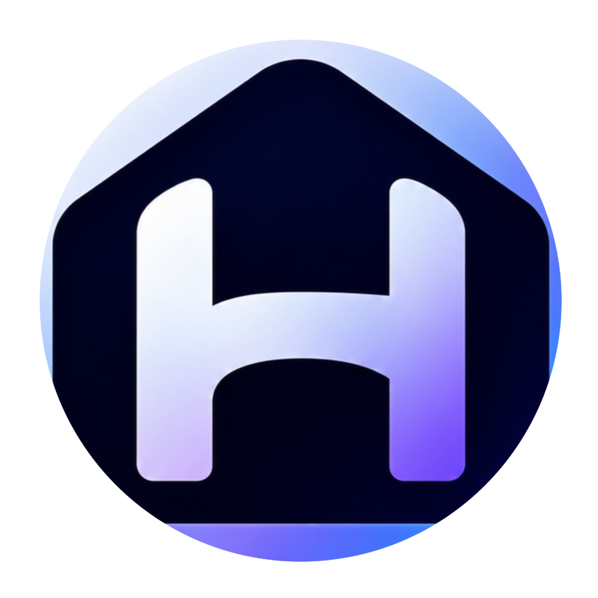
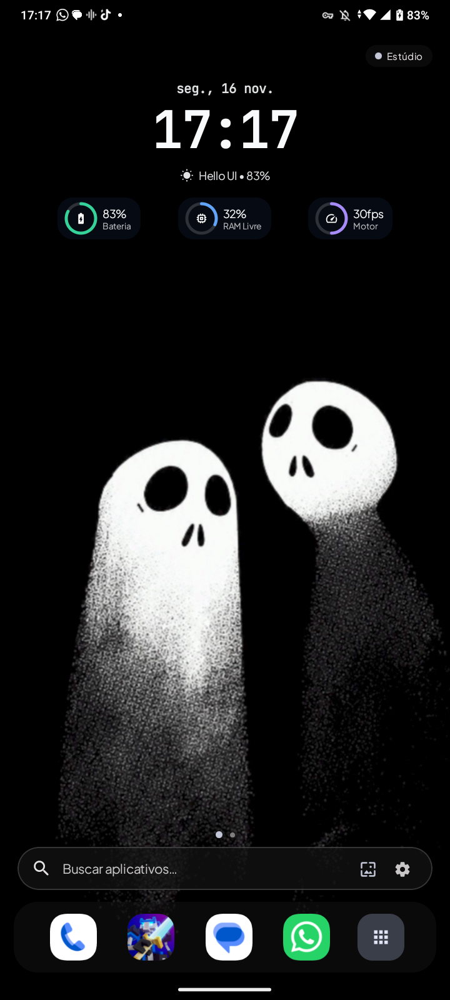
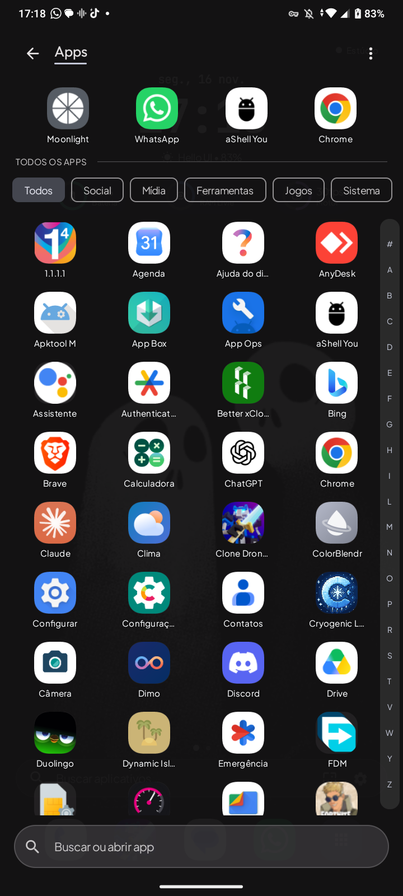
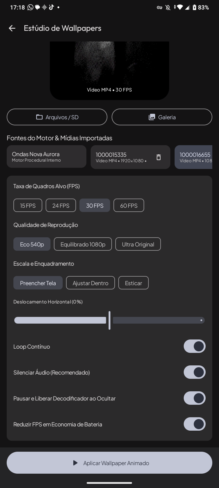
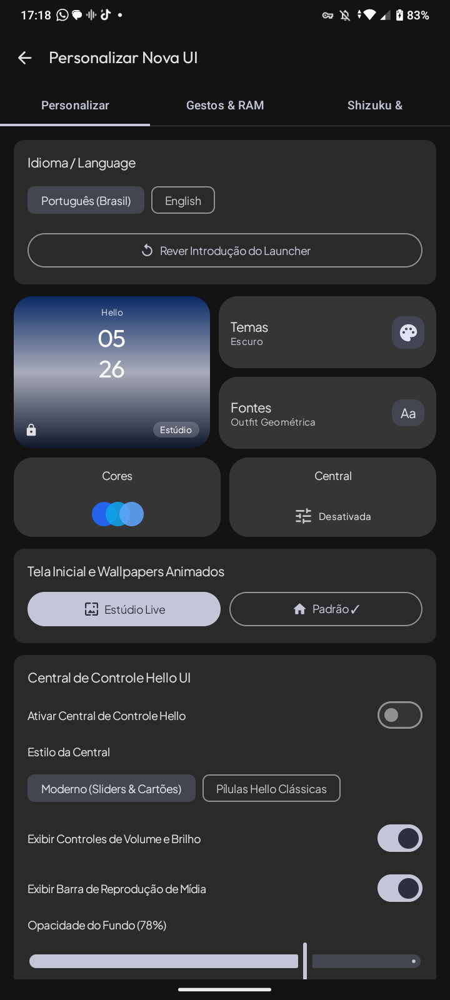
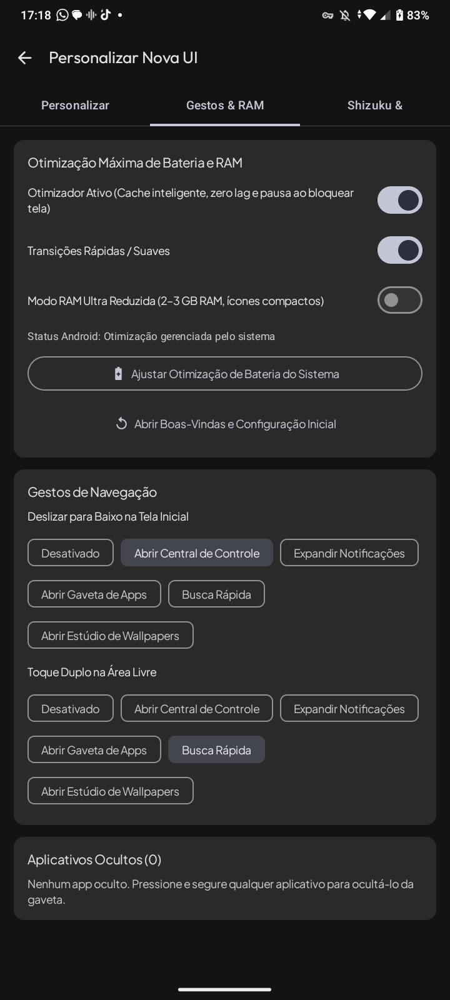
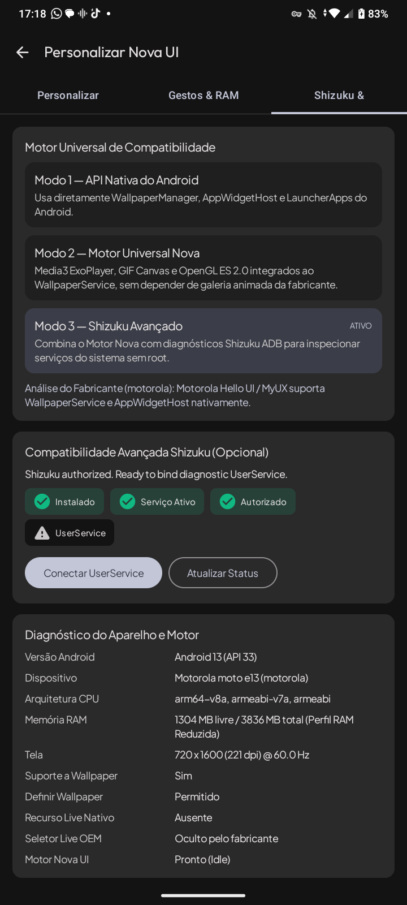

# Nova UI Launcher

  

  

    
  

  

    
    
    
  

  

    
    
  

  

    
  

    

  **Hello UI na estrutura. Pixel no minimalismo. Material You nas cores.**

  Um launcher Android que junta a Central de Controle da Motorola, a tela inicial limpa do Pixel e o tema dinâmico do Material You 3.

---

## Sobre o projeto

O **Nova UI Launcher** nasceu de uma ideia simples: ter no Android a organização da Hello UI, a leveza visual do Pixel e as cores que acompanham o seu papel de parede.

A tela inicial é minimalista, com relógio, data e busca. Por cima dela, uma Central de Controle estilo Hello UI e um painel de personalização que mexe em fontes, cores, gestos e papel de parede. Tudo isso com indicadores de bateria, RAM livre e FPS à vista, para quem gosta de acompanhar o desempenho do aparelho.

Recursos que mexem mais fundo no sistema são opcionais e passam pelo Shizuku, então o launcher funciona sem ele.

## Funcionalidades

- **Tela inicial Pixel:** relógio e data minimalistas, barra de busca de aplicativos e dock personalizável.
- **Indicadores na tela:** porcentagem da bateria, RAM livre e FPS.
- **Central de Controle Hello UI:** dois estilos, *Moderno (divisão e controles deslizantes)* e *Clássico (pílulas Hello)*.
- **Controles da Central:** volume, brilho, barra de mídia, opacidade do fundo e área de toque configurável.
- **Cores dinâmicas:** paletas do Material You que seguem o tema do sistema.
- **Fontes e tela de bloqueio:** fonte personalizada e ajustes de aparência da tela de bloqueio.
- **Wallpaper Studio:** papéis de parede, papéis animados, função de tela inicial e opção "Definir como padrão".
- **Gestos e Apps:** atalhos de navegação e comportamento dos aplicativos.
- **Shizuku e Diagnósticos:** integração opcional para recursos avançados e informações do sistema.

> Alguns recursos dependem do aparelho, da versão do Android e das permissões concedidas.

## Preview

  <table>
    <tr>
      <td align="center" width="33%">
        <strong>Tela inicial</strong>  
        
      </td>
      <td align="center" width="33%">
        <strong>Aba Apps</strong>  
        
      </td>
      <td align="center" width="33%">
        <strong>Wallpaper animado</strong>  
        
      </td>
    </tr>
    <tr>
      <td align="center" width="33%">
        <strong>Configurações</strong>  
        
      </td>
      <td align="center" width="33%">
        <strong>Gestos e RAM</strong>  
        
      </td>
      <td align="center" width="33%">
        <strong>Shizuku</strong>  
        
      </td>
    </tr>
  </table>

# De onde vem cada parte

<table>
  <tr>
    <th align="center">Inspiração</th>
    <th align="center">O que o Nova UI leva</th>
  </tr>
  <tr>
    <td align="center"><b>Motorola Hello UI</b></td>
    <td align="center">Central de Controle, tipografia e elementos de interface</td>
  </tr>
  <tr>
    <td align="center"><b>Google Pixel</b></td>
    <td align="center">Tela inicial, relógio e layout minimalista</td>
  </tr>
  <tr>
    <td align="center"><b>Material You 3</b></td>
    <td align="center">Cores dinâmicas, superfícies arredondadas e temas adaptativos</td>
  </tr>
</table>

## Informações do projeto

<table>
  <tr>
    <td align="center"><b>Nome</b></td>
    <td align="center">Nova UI Launcher</td>
  </tr>
  <tr>
    <td align="center"><b>Plataforma</b></td>
    <td align="center">Android</td>
  </tr>
  <tr>
    <td align="center"><b>Android mínimo</b></td>
    <td align="center">Android 13 (compatibilidade alvo)</td>
  </tr>
  <tr>
    <td align="center"><b>Design</b></td>
    <td align="center">Hello UI, Pixel e Material You 3</td>
  </tr>
  <tr>
    <td align="center"><b>Integração</b></td>
    <td align="center">Shizuku (opcional)</td>
  </tr>
  <tr>
    <td align="center"><b>Status</b></td>
    <td align="center">Em desenvolvimento</td>
  </tr>
</table>

## Requisitos

- Dispositivo com Android 13 ou superior.
- Permissões concedidas ao launcher, como overlay global para a Central de Controle.
- Shizuku instalado e iniciado, apenas para os recursos que dependem dele.

## Download

Baixe a versão mais recente na página de releases.

  

## Repositório e colaboração

- **Repositório:** [YTAgenteAndroidOFC/Nova-UI-Launcher](https://github.com/YTAgenteAndroidOFC/Nova-UI-Launcher)
- **Downloads:** [GitHub Releases](https://github.com/YTAgenteAndroidOFC/Nova-UI-Launcher/releases)
- **Problemas e sugestões:** [Issues](https://github.com/YTAgenteAndroidOFC/Nova-UI-Launcher/issues)

## Status do projeto

O Nova UI está em desenvolvimento, com foco em desempenho, compatibilidade entre aparelhos e integrações de sistema confiáveis. Recursos e opções podem mudar pelo caminho.

## Créditos

Inspirado em Motorola Hello UI, Google Pixel Launcher, Material Design 3 e Android Open Source Project. Todas as marcas e nomes de produtos pertencem aos seus respectivos proprietários.

  ---

  **Nova UI Launcher**

  *Personalize seu Android. Redefina sua experiência.*

